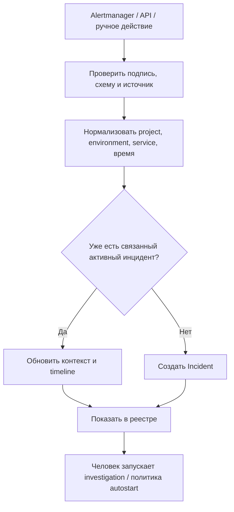

# 01. Бизнес-логика — как работает продукт

**Перспектива:** правила предметной области, независимо от реализации React/FastAPI/LangGraph.

## 1. От подключения проекта до первых данных

1. Администратор создаёт **Project**.
2. Задаёт одно или несколько **Environment**; регистрирует **Services** и разрешённые источники.
3. Добавляет **Integrations**: телеметрия, код, deployment history. Секреты сохраняются защищённо и не возвращаются в UI.
4. Нажимает «проверить подключение»: платформа подтверждает доступность и полномочия, а не просто валидность URL.
5. Формирует связи между именами сервисов в источниках, чтобы `payment-service` в логах, метриках и трейcах обозначал одну сущность.

Проект — граница доступа: пользователь и агент могут видеть только разрешённые им источники и сервисы.

## 2. От сигнала до Incident

Входящий alert — не утверждение о причине. Он может быть ошибочным, дублированным или неточным. Main Backend дедуплицирует события по надёжным идентификаторам источника, не по одному только похожему тексту.

## 3. Как живут Incident и Investigation

| Сущность | За что отвечает | Пример статуса |
|---|---|---|
| Incident | Состояние реальной проблемы и её обработки людьми | `open`, `investigating`, `awaiting_review`, `resolved` |
| Investigation | Состояние отдельного AI-запуска | `queued`, `running`, `completed`, `inconclusive`, `failed`, `timed_out`, `canceled` |

**Не путать:** «AI completed» **не значит** «инцидент исправлен». Точно так же «AI failed» не обязан закрывать инцидент.

Один Incident → много Investigation по мере повторов. Retry создаёт новый ID/attempt, историю предыдущего запуска не удаляет.

## 4. Что происходит при запуске расследования

1. Developer/Admin выбирает Incident и отправляет `Start investigation`.
2. Main Backend проверяет RBAC, Project scope и допустимость запуска.
3. Записывает попытку/контекст и отправляет асинхронную команду AI Backend. **Не ждёт 20 минут в HTTP-запросе.**
4. AI Backend принимает выполнение либо возвращает контролируемый отказ из-за занятости/недоступности.
5. При принятии запускается агент; прогресс и итог попадают обратно в Main Backend.
6. Main Backend **сохраняет** события и раздаёт их браузеру через WebSocket; после reconnect браузер может дочитать историю.

Прямое взаимодействие Main↔AI **без RabbitMQ** — актуальная договорённость. Протокол сервиса и политика конкуренции описаны в исходном пакете как кандидаты, не как безусловно завершённые implementation contracts.

## 5. Логика расследования

Агент выбирает **из доступных** read-only инструментов, а не проходит фиксированный скрипт «всегда вызови все 14». Анализирует данные, добавляет Evidence с ID и временны́м окном, ведёт не более трёх гипотез, объясняет, что поддерживает или опровергает гипотезу, формирует RCA либо честный `inconclusive`.

Нельзя присвоить высокую уверенность только потому, что два источника повторяют одну и ту же неподтверждённую ошибку. Время события само по себе не доказывает причинность.

## 6. Логика review и завершения

1. Инженер читает итог и раскрывает Evidence.
2. Подтверждает (`confirmed`), отклоняет (`rejected`) или корректирует (`corrected`) вывод AI.
3. Review ссылается на конкретную Investigation и сохраняется как **отдельная запись**, не меняя оригинальный RCA.
4. После реального устранения/подтверждения инженер явно переводит Incident в Resolved.

Review — проверка диагноза. Resolve — утверждение об устранении инцидента. Это разные операции.

## 7. Особые ветки

| Ситуация | Ожидаемое поведение |
|---|---|
| Алерт приходит повторно | Idempotent ingest; нет дублирования одного и того же события |
| Источник логов недоступен | Инструмент возвращает ошибку; агент ищет другие Evidence или `inconclusive` |
| Агенту не хватает доказательств | Завершает `inconclusive` с ограничениями, без вымышленной причины |
| Превышен бюджет | Завершает bounded timeout/лимит и сохраняет доступные результаты |
| Нажат Cancel | Запрошена кооперативная отмена; статус `canceled` только после подтверждения |
| Нажат Retry | Создан новый run; старый RCA и события остаются |
| Отвалился WebSocket | AI продолжает; UI показывает reconnect и загружает пропущенные события |
| Нет прав на проект | Backend отклоняет команду и чтение; скрытие кнопки на UI не является защитой |
| Доказательство больше не доступно в источнике | Сохранённый excerpt с provenance может остаться; UI предупреждает об отсутствии оригинала |
| Потерян итоговый callback | Надо обеспечить повтор и readback/доставку до фиксации результата; конкретный механизм — предмет контракта |

## 8. Базовые инварианты

- Нельзя показывать Review для незавершённого RCA как будто диагноз готов.
- Нельзя выполнять tool calls вне разрешённого Project/Environment.
- Нельзя удалять старую историю при повторном запуске.
- Нельзя делать автоматический production fix.
- Нельзя показывать «полное расследование» без сведений о пропущенных/недоступных источниках.

См. [use cases](02_USE_CASES.md) и [сквозной путь](09_END_TO_END.md).
