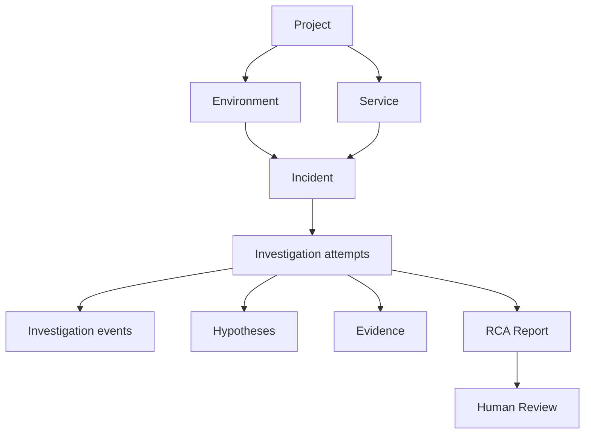

# 05. Backend — серверная бизнес-система

**Перспектива:** где существует истина о проектах, инцидентах, пользователях, правах и отчётах.  
**Владелец функциональной области:** Юрий (Main Backend); аутентификация в организации может разрабатываться как отдельный сервис, но для Frontend остаётся частью согласованного server API.

## 1. Главная функция Backend

Main Backend — **координатор продукта и источник истины** для пользовательских и доменных сущностей. Он знает, кому принадлежит проект, какой alert создал Incident, кто и когда запустил расследование, какие результаты пришли от AI, что увидел и подтвердил человек. Он не обязан сам решать, почему произошёл сбой: эту работу выполняет AI Backend.

## 2. Области ответственности

| Область | Что хранит / обеспечивает | Взаимодействие |
|---|---|---|
| Identity/Auth | пользователи, пароль, login challenge, OTP, токены/сессии | Browser ↔ API |
| RBAC/Scope | Admin/Developer/Viewer, права на Project | проверка для каждого действия и чтения |
| Project registry | Project, Environment, Service, связи, имена источников | конфигурация диагностики |
| Integrations | тип источника, endpoint, credentials ref, test status | MCP/адаптеры, защищённые хранилища |
| Ingestion | alerts, webhook signatures, deployments, dedup | external monitoring → Backend |
| Incidents | summary, service(s), status, severity, timestamps | UI, incident lifecycle |
| Investigations | run ID, attempt, status, события, корреляция | Backend ↔ AI |
| Evidence/RCA/Review | структурированные результаты, ссылки, решения человека | UI, аудит |
| Realtime | устойчивое хранение событий, browser WebSocket | History GET + live push |

## 3. Доменная модель и владение данными



Некоторые связи many-to-many: один Incident может затрагивать несколько Services, а Evidence может относиться к нескольким гипотезам. **Не выводить готовую SQL-схему только из этой диаграммы.**

PostgreSQL Main Backend хранит домен и метаданные результатов. **Сырые гигабайты логов не нужно копировать в Incident DB**: сохраняются ограниченные excerpt, источник, время и URL. Checkpoints исполнения — ответственность AI Backend, логически изолированная от основной БД.

## 4. Что происходит с Alert

- Проверка origin/auth/signature/replay protection.
- Валидация payload и нормализация timestamp, severity и service.
- Поиск проекта и окружения; отказ или карантин, если источник не сопоставлен.
- Dedup одного и того же внешнего события.
- Create/update Incident и добавление timeline.
- Обновление Overview и Incidents для подписанных клиентов.

Ingestion должен поддерживать как минимум общий Alert JSON и Alertmanager webhook по схемам исходного пакета; история deployment также поступает в Backend через отдельный контур.

## 5. Как Backend общается с AI

```text
Browser  -> Main: Start investigation (incident_id)
Main     -> AI:   асинхронная команда Start(context, ids, budgets)
AI       -> Main:  status / progress events / final RCA
Main     -> DB:    сохраняет события, RCA и метаданные
Main     -> Browser: WebSocket события и REST-readback
```

- Вызов **прямой**, RabbitMQ на этой границе нет.
- Frontend не общается с AI напрямую.
- `202 Accepted` означает принятие задачи, а не готовый RCA.
- При одинаковой команде повтор из-за сети не должен порождать лишний run.
- Входящие callbacks от AI проходят отдельную **межсервисную авторизацию**, проверку схемы, дедуп по `event_id` и `(investigation_id, sequence)`.
- UI получает **сохранённое** событие. Если push WebSocket сорвался, событие доступно через историю.
- Потеря единственного callback не может навсегда лишить пользователя финального RCA; требуется согласованное надёжное доставление/readback.

## 6. API с точки зрения продукта

| Группа API | Основные действия | Где используется |
|---|---|---|
| Auth | login → OTP verify, resend, logout/refresh | Login/OTP |
| Projects / services | list/create/configure в пределах RBAC | Integrations, Settings, Overview |
| Incidents | list/filter, detail, timeline, status | Overview, Incidents, Detail |
| Investigations | start, get, cancel, retry, history/events | Live, Detail |
| Evidence / RCA | get hypotheses, evidence, report | Detail tabs |
| Review | create/list confirm/reject/correct | RCA report |
| Observability views | bounded logs/metrics/traces/source links | Explorer, Evidence |
| Ingestion | signed alerts/deployments | external services |
| WebSocket | subscribe/reconnect/replay | Live, Overview |

Точные field names и endpoint shapes берутся из **актуализированного** OpenAPI/JSON Schema; этот документ фиксирует смысл и границы, а не вторую конкурирующую версию контракта. В исходном архиве есть `openapi/main-backend.openapi.yaml`.

## 7. Безопасность как бизнес-требование

- Browser login: пароль + **OTP при каждом новом входе**, до OTP токен не выдаётся.
- Server-side проверка доступа по Project и роли для REST, WS и связанных инструментов.
- AI получает ограниченный внутренний контекст, а не пользовательские секреты.
- Connection secrets хранятся отдельно и не возвращаются как plaintext.
- Из пользовательского запроса нельзя выполнить произвольный SQL, shell, Docker exec или открыть arbitrary URL через diagnostic tool.
- Review и критические изменения обязательно сохраняются для аудита.

## 8. Где Backend заканчивается

Main Backend **не выполняет цикл ReAct и не заставляет браузер напрямую вызывать llama-server**. AI Backend не управляет пользователями/проектами и не пишет чужие incident-таблицы напрямую. Различать «сервис отвечает за функцию» и «каждая функция отдельный микросервис».

## 9. Что считается готовностью этой части

- Можем войти через OTP и доказать RBAC.
- Можем зарегистрировать источник, принять настоящий тестовый alert и создать Incident.
- Можем принять Start и вернуть ID run без блокировки до RCA.
- События и итог сохраняются в PostgreSQL, replay работает после reconnect.
- Существуют human review, audit и корректная смена статуса Incident.
- Невалидные/повторные/чужие события не ломают систему и не обходят права.

См. [бизнес-логику](01_BUSINESS_LOGIC.md), [агента](06_AI_AGENT.md), [сквозной сценарий](09_END_TO_END.md).
