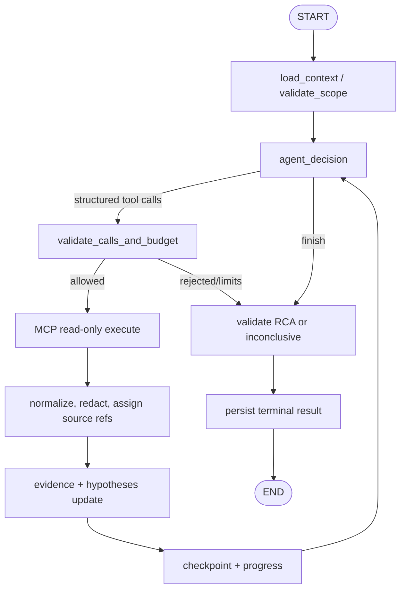

# 06. AI Backend и LangGraph агент — спецификация разработки

**Владелец:** Олег. **Репозиторий:** `AI-Incident-Investigation-Platform/ai_agent`. **Стек:** Python/FastAPI, Pydantic v2, LangGraph, llama.cpp `llama-server`, Qwen2.5-Coder-7B-Instruct GGUF Q4_K_M, `httpx`, MCP Streamable HTTP, PostgreSQL checkpoints + durable run registry. **Текущий реализованный факт:** одноузловой `LangGraph → LlamaCppProvider → реальная Qwen` smoke (AI-01); это не автономное расследование. **Источник контракта:** [12_INTERSERVICE_CONTRACTS.md](12_INTERSERVICE_CONTRACTS.md).

## 1. Функция AI Backend и граница владения

AI Backend принимает **внутренний асинхронный** Start от Main Backend, управляет выполнением, вызывает модель и **только разрешённые read-only диагностические MCP-инструменты**, сохраняет checkpoint/evidence, публикует progress/result в Main, умеет cancel/recovery. Не владеет users/auth, Incident lifecycle, WebSocket, review или production remediation.

**Фиксированная модель:** один ReAct-агент с детерминированным LangGraph-контролем, не CrewAI/multi-agent. LLM предлагает действие; приложение валидирует его до любого сетевого вызова. Не делаем фактическое выполнение tool call только на основании JSON текста, напечатанного моделью.

## 2. Runtime boundaries

```text
Internal FastAPI REST (Start/Get/Cancel/GetResult/Health)
    ↓ validate service identity + Pydantic DTO + project scope
Application: RunService / Admission / Dispatch / Cancellation
    ↓ durable run row + checkpoint + runtime executor
LangGraph StateGraph
    ↓ LLM Adapter → llama-server on host/Metal Qwen
    ↓ MCP Client → MCP Server (read-only) → Loki/Prometheus/Tempo/GitHub
    ↓ EvidenceStore/HypothesisAggregator/RCAValidator
Progress/result persistent outbox → Main Backend internal callbacks
```

**Local development:** llama-server доступен из хостового Python по `127.0.0.1:8080/v1`; внутри Docker `localhost` — контейнер, поэтому использовать на macOS `host.docker.internal` при поддержке окружения. Модель запускается отдельно; AI service её не скачивает при старте. Тяжёлые операции не должны блокировать FastAPI event loop.

## 3. План каталогов — эволюция существующего `src/ai_agent`

```text
src/ai_agent/
  api/                   # internal FastAPI routes, auth middleware, DTO mapping
  application/           # RunService, dispatcher, cancellation, result delivery
  domain/                # Investigation, Evidence, Hypothesis, RCA, transitions
  agent/
    graph.py             # StateGraph, compile
    state.py             # durable validated AgentState
    nodes/               # prepare, decide, execute_tool, evidence, finalize
    prompts/             # versioned system/task prompts, injection rules
  llm/
    types.py             # tool-capable typed messages / response
    providers/llama_cpp.py
  mcp/
    client.py            # Streamable HTTP, discovery, calls, timeouts
    schemas.py           # allowed tool inputs/outputs and normalized status
    policy.py            # project/env/service/time and read-only enforcement
  runtime/
    checkpoints.py       # LangGraph Postgres checkpointer
    registry.py          # durable run leases/admission
    executor.py          # one active per executor, deadlines/cancel
  delivery/
    events.py            # monotonic event ID/sequence, sanitization
    outbox.py            # retryable callbacks
    results.py           # full result submit/readback
  core/                  # Pydantic settings, logging, tracing
scripts/                 # smoke_llm, smoke_mcp, scenario eval
 tests/                  # unit, contract, integration, live opt-in
```

Не переименовывать уже работающие модули без причины. Разделить в ранних Story `probe_graph` (AI-01) и **настоящий investigation graph** (AI-04+), не маскировать первый под второй.

## 4. Структура AgentState и память

LangGraph state должен быть **достаточно полным для рестарта**, но не хранить мегабайты сырых логов:

| Поле | Тип / смысл | Кто меняет |
|---|---|---|
| `investigation_id`, `incident_id`, `project_id`, `environment_id`, `service_ids` | UUID/scope, immutable | start adapter |
| `window` | RFC3339 UTC range, bounded | start/context |
| `alert_summary`, `service_context` | sanitized input | prepare |
| `messages` | короткий bounded context model turns | decision/tool nodes |
| `current_step`, `tool_calls_count` | counters under hard caps | runtime |
| `pending_tool_calls` | validated structured calls | decision |
| `tool_observations` | normalized bounded results, source refs | tool node |
| `evidence` | normalized Evidence[] | evidence node |
| `hypotheses` | ≤3 typed candidates + evid links | hypothesis node |
| `timeline` | observed/correlated/supported events | evidence node |
| `result` | typed RCA or terminal error | finalize |
| `deadline_at`, `cancel_requested`, `error_context` | control flags | runtime |
| `llm_model`, `prompt_version`, `tool_catalog_version` | reproducibility metadata | runtime |

LangGraph checkpointer хранит state снапшоты; **run registry** отдельно хранит lifecycle/leases/attempt/status. Не рассчитывать на checkpoint как на единственный registry и наоборот. Сырой prompt/tool output ограничить, sanitized, хранить только нужное. `thread_id = investigation_id` и checkpoint namespace согласован на один run.

## 5. LangGraph переходы — детерминированный контроль



Переходы должны быть воспроизводимы с fake LLM/MCP. **LLM не выбирает возможность обхода Policy.** Проверка cancel/deadline до модельного вызова, между вызовами и перед каждым MCP tool call. Финализация гарантирует терминальное состояние даже при ошибках, кроме аварийного убийства процесса (recovery).

### Алгоритм одного шага

1. Из checkpoint/load context получить текущие сообщения, бюджет, число вызовов.
2. Собрать system prompt с ролью, безопасными разрешёнными инструментами и источниками. Не включать ground truth demo сценария.
3. Отправить в LLM Provider `messages + tools` через OpenAI-compatible API.
4. Требовать structured `tool_calls` (tool name + JSON args) либо structured final action; если llama.cpp выдаёт JSON **текстом**, это **не** подтверждённый native tool calling. AI-02 benchmark определяет поддерживаемый режим (возможно `--jinja`/chat template).
5. Валидировать tool name/args в Pydantic, tool catalog version, service IDs, time window, allowlist, max query size, no external URLs.
6. Вызвать MCP Streamable HTTP `tools/call` с per-call timeout и correlation ID; Tool result normalize to ok/empty/partial/truncated/error.
7. Не трактовать untrusted log text как system instructions; удалить/экранировать секреты; сохранить provenance из реального инструмента.
8. Только из tool result формировать Evidence и обновлять hypotheses. Claim про внешнюю систему без source ref нельзя помечать high confidence.
9. Emit event с operation summary, не chain-of-thought, commit checkpoint; повторять loop или finalize.
10. На `finish` собрать Pydantic RCA; проверять ID ссылок, outcome, no fake sources; при слабых данных `inconclusive` с limitations.

## 6. LLM Provider: precise API behaviour

`LlamaCppProvider` async httpx posts `/v1/chat/completions`; config `AI_AGENT_LLM_BASE_URL`, `MODEL`, `TIMEOUT_SECONDS`, `CONNECT_TIMEOUT_SECONDS`, `MAX_TOKENS`, temperature. `model` должен совпадать `/v1/models`. Typed response содержит `content`, structured `tool_calls`, `finish_reason`, usage/diagnostic metadata. HTTP 429/502/timeouts = provider error, не успешное пустое сообщение. JSON parse errors и отсутствующий `choices[0].message` — malformed response. `finish_reason=length` (truncated) нельзя считать достоверным структурированным результатом.

**AI-02 gate:** тест 20–30 controlled prompts with one or multiple tools (plain/tool/invalid/ambiguous); проверка JSON schema аргументов, правильного tool name, handling no tool, latency, стабильности. Если native tool calling не подтверждён, документировать альтернативный **строго валидируемый structured-output adapter**, не делать скрытый eval парсинга строк модельного текста. Нет tool execution без policy validation.

## 7. MCP: конкретные инструменты и источник

**Выбор MVP:** отдельный внутренний read-only MCP Server внутри AI workstream, сервисный доступ только с AI Client; source-specific credentials хранятся у сервера. Транспорт Streamable HTTP, правильные `tools/list`, `tools/call`, MCP protocol/session handling; не реализовывать произвольные REST endpoints типа `/mcp/search_logs` вместо стандарта.

| MCP tool | Бэкенд | Input (ядро) | Output / evidence |
|---|---|---|---|
| `search_logs` | **Loki LogQL API** | project/env/service, UTC from/to, severity/query, limit | log entries with timestamp, source locator, excerpt, truncated |
| `query_prometheus` | Prometheus HTTP API | scoped validated PromQL, time range, step, series limit | units/labels/time series + query URL/series source ref |
| `get_trace` | Tempo API | exact trace ID and project scope | spans + service/latency + trace locator |
| `get_service_health` | metrics + safe health | service ID/window | availability/5xx/latency summary, provenance |
| `get_recent_deployments` | Main Backend internal registry | service/time range | version/commit/deployment IDs |
| `github_search_code`, `github_get_file` | GitHub read-only | allowlisted repo/path/ref/query | file/commit permalinks + SHA |
| `github_get_commit`, `github_compare_commits`, `github_get_blame` | GitHub read-only | repository, sha/ref,path | diff/commit provenance |
| `http_health_check` | Allowlisted target | service-mapped URL only | response status/latency, no arbitrary URL |
| `get_incident_context` | Main internal | incident_id scoped by signed run | current Incident metadata |

**`get_container_status`, `get_container_events` из исходного каталога**: текущий production-like стенд основан на k3d, а не единственном Docker socket. Не дать LLM прямой Docker socket; согласовать restricted Kubernetes read-only adapter (pod status/restarts/events), сохранив согласованные tool names через schema migration; до него явно `not_supported`, не фальсифицировать Docker results. В `v0.2` `search_logs` ссылался на Elasticsearch: для фактического `infra` используем **Loki adapter** и обновлённый tool catalog, потому что соответствие имени инструмента не означает совместимость старых query schemas.

### Унифицированный наблюдаемый результат

```json
{
  "status":"partial",
  "source_type":"loki",
  "source_id":"loki:payment-service:2026-10-25T12:31:01Z:sample",
  "observed_at":"2026-10-25T12:31:01Z",
  "items":[{"timestamp":"2026-10-25T12:31:01Z","service":"payment-service","level":"error","message":"database connection acquisition timeout"}],
  "truncated":true,
  "limitations":["result limit reached"],
  "source_url":null
}
```

Это **проектный пример нормализации**, не literal schema, уже реализованная в реальном MCP server. Источник должен содержать locator, который можно повторно проверить; если честного source_url нет, возвращаем null + source_id. Никаких мнимых ссылок.

## 8. Evidence → Hypotheses → RCA

### Evidence record

- `id`, `investigation_id`, `title`, `summary`, bounded `excerpt`, `collected_at`;
- `source: {source_type,source_id,url?,observed_at?,metadata}`;
- `service_ids[]`, `hypothesis_ids[]`, optional `truncated/partial`;
- Every Evidence created from a specific returned tool observation; ID of source must exist in tool result. Dedup by normalized source fingerprint.

### Hypothesis

`id,title,explanation,status=pending|supported|rejected,confidence=low|medium|high,evidence_ids[]`. Не более 3, confidence — quality label, не выдуманное числовое 0.98. Шум в логах не равен доказательству root cause. Подтверждение причинности требует нескольких согласующихся фактов или точного прямого evidence.

### RCA

`report.outcome=completed|inconclusive`, `summary`, `symptoms`, nullable `root_cause`, `causal_chain`, `evidence_ids`, `hypothesis_ids`, `timeline`, `confidence`, `remediation`, `prevention`, `limitations`. Для `inconclusive` `root_cause=null` и честные ограничения. Для `completed` причина должна опираться на фактически полученные Evidence. LLM не делает rollback/patch/restart, только предлагает текст плана с validation человеком. Сырые chain-of-thought/reasoning traces не логировать/публиковать, operational summaries разрешены.

**Пример рассуждения без фальсификации:** Prometheus реально показывает рост 5xx, Loki реально возвращает `PoolTimeout`, Tempo подтверждает длительные DB spans; deploy произошёл раньше — это корреляция, не автоматическое доказательство плохого deploy. Agent может установить `DB connection pool exhaustion likely`, но отличить причину истощения от симптома требуется дополнительная проверка транзакций, query time и version delta.

## 9. Бюджеты, cancel и terminal states

Hard limits сервера: **20 LangGraph agent steps, 40 MCP tool calls, 1200 секунд**, из конфигурации допускается только меньшее значение без специальной approved policy. По умолчанию concurrency = 1 active run на executor. Step count не равен проценту progress. Deadline — wall clock с persistent `deadline_at`, не только timeout конкретного HTTP. Каждый tool call имеет меньший per-tool timeout; concurrency в параллельных вызовах не должна обходить budget.

- При бюджетном исходе достаточно фактов → `inconclusive` если допустимо и есть корректная summary; техническое превышение deadline → `timed_out` с partial evidence.
- Ошибка отдельного MCP tool → `partial`/другая гипотеза либо `inconclusive`, не глобальная `failed` по умолчанию.
- Сбой LLM runtime, database checkpoint, corrupted state → `failed`, с техническим `failure_code` и safe message.
- Cancel: cooperative, проверяется между steps и перед tools; `canceled` сохраняет доступные частичные наблюдения, если безопасно.
- Retry только Main Backend → **новая investigation_id**, нового run нельзя присоединять к старому checkpoint thread.
- First durable terminal win; повторные callbacks идентичны и дедуплицируются.

## 10. Durable execution и PostgreSQL

Запрос Start создаёт/находит durable run registry row и принимает его только после commit. Runner отдельно от HTTP coroutine и FastAPI `BackgroundTasks`. Для локального стенда допустим **один долгоживущий executor процесс** с PG advisory lock/lease; его можно рестартовать без потери принятых run IDs.

Предлагаемые таблицы AI DB:

- `ai_runs(investigation_id PK,incident_id,project_id,attempt,status,deadline_at,lease_owner,lease_expires_at,cancel_requested,started_at,finished_at,failure_code,version)`;
- `ai_outbox(id PK,investigation_id,event_id,sequence,payload,delivery_status,next_retry_at,attempts,UNIQUE(investigation_id,sequence))`;
- `ai_results(investigation_id UNIQUE,status,payload,committed_at,main_ack_at)`;
- LangGraph PostgreSQL checkpointer tables (managed by library's migration/init, **отдельный namespace**).

Runner lifecycle: take lease → load checkpoint or start state → loop → write checkpoint/events → save final result + outbox → ack Main; lease renewal periodic. Crash before callback: outbox retries; crash after callback before ack: duplicate accepted; crash during tool call: avoid replay of side-effect by using **read-only** tools and stable source observation policy; no endlessly stuck `running` after lease expiry. Recovery agent checks terminal state and resumes if safe; on ambiguous irrecoverable state marks `failed` and sends result. DB connection pool tuned for local workload (one run), not unbounded parallel load.

`GET /internal/v1/investigations/{id}/result`: terminal result available for reconciliation; before completion `409`; this is recovery path if callback dropped. AI never sets Incident status; Main owns final projection.

## 11. Delivery: events and results

- `event_id` UUID and `sequence` increment exactly once per emitted logical event (persist before HTTP).
- Event payload max bounded, no raw full logs. `tool.started`,`tool.completed`,`tool.failed`,`hypothesis.updated`,`investigation.started`,`investigation.completed/inconclusive/failed/timed_out/canceled` as approved catalog.
- Callback HTTP client sends service JWT and correlation; 5xx/timeouts retry with backoff+jitter and same event ID. 422 means schema/implementation bug: audit + dead-letter style retained pending item for operator, not infinite rapid retry.
- Terminal result persisted before `POST /internal/v1/ai/results`; on Main ack mark delivered, keep durable copy for reconciliation.
- Don't send external callback URL from run payload; Main URL only from trusted env config.

## 12. Security and attack surface

- Prompt injection: tool output is **untrusted data**, never executes instructions found in logs, Github repo files or Grafana text.
- Scope every tool using signed project/environment/service allowlist passed by Main, enforce again MCP side; no arbitrary PromQL or Loki query that escapes tenant scope.
- No shell, arbitrary SQL, Docker exec, deletion, production restart, write to GitHub, unrestricted HTTP GET.
- Secrets masked at boundaries, log excerpts sanitized, outbound size/time/trace limits.
- Evidence URLs only trusted sources; malicious strings not interpolated into HTML.
- Service-to-service JWT `aud`, `iss`, TTL, scopes; deny browser token.

## 13. Testing pyramid and AI Story gates

| Story/gate | Реальный результат | Обязательные проверки |
|---|---|---|
| AI-01 | одноузловой LLM graph calls Qwen | fake provider unit, optional live smoke; **не** MCP/RCA |
| AI-02 | tool calling spike | structured calls/schema validity/latency, report fallback |
| AI-03 | domain+contract DTO | Pydantic invalid/out-of-scope/round-trip fixtures |
| AI-04 | deterministic graph with fake tools | transitions, loop, budgets, cancel |
| AI-05/06 | MCP client + policy | `tools/list`, `tools/call`, timeout, redaction, blocked tools |
| AI-07/08 | Evidence/Hypotheses/RCA | no phantom refs, ≤3, inconclusive when insufficient |
| AI-09 | bounded termination | steps/tools/deadline/cancel races |
| **G01** | local E2E, fake MCP + optionally real model | pass/fail, no need PostgreSQL checkpoints |
| AI-10/11 | PG + durable executor | restart/recovery, 429 admission, lease races |
| AI-12/13 | callbacks and Main REST | duplicates/out-of-order/readback, service auth |
| AI-14/15 | instrumentation and eval | six reproducible scenarios, source-grounded grading |
| **G02/G03** | durable integration + MVP acceptance | full recovery, E2E, human review, no auto remediation |

**Обязательная поправка к task-pack:** **G01 — барьер перед AI-10**, даже если старый README упоминал только AI-04 и решение PG. `QUALITY_GATE` применяется по объёму конкретной Story; отсутствие поздних функций не дефект AI-01. RAG/embeddings/reranking/intent classifier — **P2 и не блокируют MVP**.

## 14. Сопоставление с реальным окружением

Demo Payment Service Даниила генерирует повторяемые сценарии и настоящие observable признаки. Loki/Prometheus/Tempo уже присутствуют в `infra` репозитории. До AI E2E нужны `service.name`, `deployment.version`, real time window, source locators. **Ground truth** из demo сценария используется только evaluator, не в prompt или MCP.

### Definition of Done AI MVP

1. Main Start → 202 durable admitted; рабочий executor продолжает после HTTP завершения.
2. Agent вызывает реальные разрешённые MCP tools либо честно возвращает inconclusive, когда источники недоступны.
3. Каждая важная root-cause claim подтверждена проверяемыми Evidence IDs.
4. Progress/events и terminal RCA надёжно попадают в Main Backend; после restart/run readback данные не теряются.
5. 20/40/1200, cancel, retry/new ID, busy 429 выполняются кодом, не только prompt.
6. Нет production writes, chain-of-thought leakage, ложных ссылок или реальных финансовых операций.
7. Contract/unit/integration/eval тесты проходят, реальный live smoke отделён от fake.

**Передача Юрию:** internal REST OpenAPI + callbacks fixtures + service identity spec + 429/recovery tests. **Передача Даниилу:** каталог supported Loki/Prometheus/Tempo labels and source IDs. **Передача Расулу:** никаких прямых AI endpoints, весь live идёт через Main.
