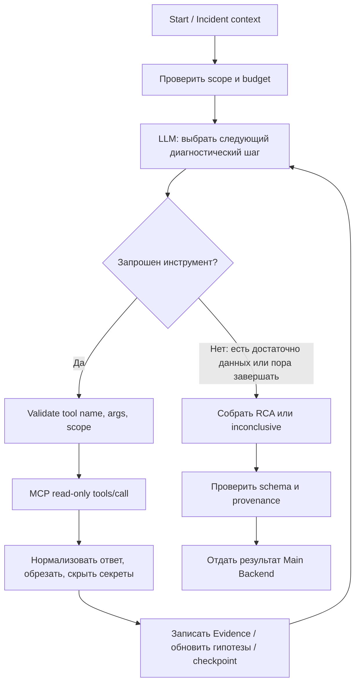

# 06. AI-агент — как проходит расследование

**Перспектива:** отдельный AI Backend Олега — логика поиска, гипотез и доказательств.  
**Стек выбранного прототипа:** Python, LangGraph, один ReAct-агент, локальная Qwen2.5-Coder-7B-Instruct в GGUF Q4_K_M через `llama.cpp/llama-server`, read-only MCP Client.

## 1. Задача AI-слоя

AI-слой принимает **структурированный контекст Incident**, выбирает инструменты, получает технические наблюдения и составляет RCA. От него ждут не уверенного рассказа, а **проверяемого исследования**. Он не управляет пользователями или статусом Incident напрямую и не исправляет production.

## 2. Как работает один ReAct-агент



Это логическая схема. Реальный граф может иметь другие имена узлов. **Не нужен отдельный planning-agent, manager-agent или список инструментов, вызываемых в фиксированном порядке**.

## 3. Что получает агент

Минимальный набор: `incident_id`, `investigation_id`, Project/Environment/Service scope, alert symptom, временной диапазон, разрешённые источники, корреляционные идентификаторы и budgets. Код не должен строить запросы к источникам вне разрешённого scope.

## 4. Что агент умеет спрашивать у инструментов

| Вопрос агента | Инструмент / источник | Тип наблюдения |
|---|---|---|
| Где выросли ошибки? | `search_logs` → логовое хранилище | структурированные ошибки со временем и source ref |
| Что менялось в нагрузке? | `query_prometheus` → Prometheus | error rate, latency, ресурсы, DB metrics |
| Где запрос замедлился? | `get_trace` → Tempo | spans, длительность, цепочка сервисов |
| Работает ли сервис? | `get_service_health`, `http_health_check` | статус, таймауты и ограниченная health-диагностика |
| Что происходило с контейнером? | `get_container_status/events` | рестарты, OOM, события |
| Была ли новая версия? | `get_recent_deployments` | время и SHA развёртывания |
| Как изменился код? | `github_search_code`, `github_get_commit`, `github_compare_commits` и другие read-only GitHub | подтверждённые файлы и diff |
| Что за инцидент? | `get_incident_context` | нормализованные данные Main Backend |

Исходный `mcp/tool-catalog.json` перечисляет 14 инструментов MVP и два дополнительных для P2. В **текущем infra** уже работает проектная конфигурация Loki, тогда как исходные `search_logs` были описаны под Elasticsearch: семантика результата может сохраниться, но физический адаптер требует согласования и тестов.

## 5. Evidence важнее текста LLM

Каждый кусок Evidence должен знать: **каким инструментом получен**, для какого сервиса/периода, с каким `source_id`, временем и проверяемым `source_ref`/URL, что именно наблюдали, был ли результат усечён. Нельзя создать source ref из текста модели, если инструмент ничего такого не возвращал.

Пример валидного наблюдения (иллюстрация):

```json
{
  "type": "log",
  "service": "payment-service",
  "observed_at": "2026-10-24T14:35:00Z",
  "summary": "12 событий таймаута получения соединения с БД",
  "source_ref": "реальный ID результата log tool",
  "truncated": false
}
```

В реальных DTO используется согласованная схема. Здесь объясняется семантика, а не контракт.

## 6. Гипотезы и RCA

**Гипотез:** не более трёх. Каждая имеет статус `pending/supported/rejected`, confidence (`High/Medium/Low`), краткое объяснение и реальные Evidence links. Подтверждение гипотезы — не синоним признанного человеком Root Cause.

**RCA Report:** summary, симптомы, affected services, вероятная root cause (или null), причинная цепочка, ссылки на гипотезы и Evidence, timeline, confidence, рекомендации по устранению/предотвращению, limitations. Случай `inconclusive` — нормальный допустимый исход.

**Пример различия:**

- Симптом: «HTTP 500 выросли с 0.2% до 8%».
- Наблюдение: «pool wait timeouts появились до 5xx».
- Гипотеза: «изменение lifecycle соединений после deployment».
- Root Cause: принимается только если имеющиеся наблюдения подтверждают цепочку; иначе гипотеза и ограничение.

## 7. Лимиты и устойчивость

- Не более **20 agent steps**, **40 tool calls**, **1200 секунд** на Investigation (серверные бюджеты, не просто промпт).
- Для MVP один активно исполняемый run на executor; overflow policy и устойчивые задания не заменяются ожиданием HTTP-запроса.
- LangGraph checkpoints в PostgreSQL — для возобновления состояния, не для хранения сырых логов без лимита.
- Cancel кооперативный, Retry создаёт **новый** investigation.
- Ошибки LLM JSON/tool args/schema → validate, ограниченная поправка, `inconclusive` или `failed`, а не бесконечный цикл.
- Внешние outputs — недоверенные, prompt injection не должен превращаться в системное указание агенту.

## 8. Принцип безопасности

Доступны **read-only** инструменты с allowlist и scope. Запрещены shell, произвольные SQL, запись в GitHub, restart/rollback/PR, произвольный Docker exec и произвольная сеть. MCP Server проверяет права независимо от того, что решила модель. Ни prompts, ни chain-of-thought, ни секреты источников не должны уходить на браузер.

## 9. Что уже реально доказано, а что нет

**Подтверждено локальной работой / отчётом AI-01:** Qwen отвечает через `llama-server`; одноузловой LangGraph вызывает `LlamaCppProvider`, есть реальный smoke и unit tests.  
**Не доказано этим тестом:** надёжный native structured tool calling, полноценный MCP loop, Evidence/RCA, 20-минутный durable executor, callbacks, E2E с Main Backend. При пробах native tool calling модель могла выдавать JSON текстом вместо структурированных `tool_calls` — это отдельная Story AI-02.

## 10. Что считать готовым AI MVP

На контролируемом инциденте агент самостоятельно выбирает инструменты, получает фактические source refs, корректно отличает симптомы от причины, возвращает RCA или `inconclusive`, соблюдает бюджеты/отмену и сохраняет прогресс. Он не должен угадывать результат по данным ground truth демонстрационного стенда.

См. [Backend](05_BACKEND.md), [бизнес-логику](01_BUSINESS_LOGIC.md), [demo/infra](08_INFRA_AND_DEMO.md).
