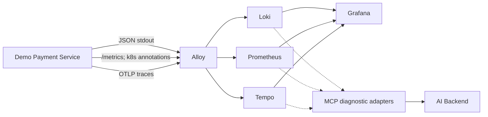

# 08. Инфраструктура и Demo Environment

**Перспектива:** где развёрнуты компоненты, откуда берутся диагностические данные и как проверить продукт на реальной технической неисправности.  
**Направление:** Даниил — инфраструктура/демостенд; совместно с владельцами сервисов.

## 1. Существующий инфраструктурный контур

В рабочем GitHub-репозитории `AI-Incident-Investigation-Platform/infra` подготовлена конфигурация **k3d-кластера `aiip`** и Kubernetes-манифесты:

| Компонент | Назначение в системе |
|---|---|
| **k3d/Kubernetes** | локальный кластер и развёртывание микросервисов |
| **Traefik** | точка входа в кластер |
| **PostgreSQL** | доменная БД и независимые хранилища сервисов |
| **DragonflyDB** | кэш, временные данные (не источник истины о RCA) |
| **SeaweedFS (S3-compatible)** | объектное хранение при необходимости |
| **Grafana** | единое UI наблюдаемости |
| **Loki** | хранение и поиск логов |
| **Prometheus** | временные ряды и метрики |
| **Tempo** | распределённые трассировки |
| **Alloy** | Kubernetes log collection, метрики и OTLP trace routing |

Это **конфигурация в репозитории**, а не безусловное утверждение, что все компоненты развёрнуты в каждую минуту у каждого участника.

## 2. Как данные должны попадать к агенту

В текущей конфигурации Alloy собирает logs Kubernetes и scrape metrics из аннотированных pod, а OTLP receiver маршрутизирует **traces** в Tempo. Не считать OTLP metrics автоматически настроенными, пока pipeline реально не изменён.

## 3. Важная расстыковка исходных документов

В исходном API пакете `search_logs` опирается на **Elasticsearch/Kibana**. В действующем инфраструктурном репозитории развёрнут **Loki**, а не Elasticsearch. Поэтому при реализации должна быть одна согласованная семантика `search_logs`, но адаптер и ссылки — к фактическому источнику. Это **не означает**, что нужно тихо переписать старые `mcp/tool-catalog.json` или выдавать прежнюю Elasticsearch-схему за работающую.

## 4. Роль демонстрационного Payment Service

Demo Payment Service — **отдельное тестовое микросервисное приложение**, не компонент денежных расчётов самого Investigator. Сервис создаёт виртуальные платежи через FastAPI, хранит транзакции в PostgreSQL, имитирует provider authorization/capture/refund, поддерживает безопасный генератор трафика и контролируемые faults.

Основной путь здоровой операции: `create → authorize → capture → optional refund`. Нет настоящих денег, реквизитов карт и внешних банковских API.

## 5. Инциденты, которые полезно подготовить

| Инцидент | Изолированная причина | Какие источники должны дать признаки |
|---|---|---|
| DB pool exhaustion | исчерпан пул SQLAlchemy connections демосервиса | errors in Loki, local pool metrics Prometheus, DB spans Tempo |
| PSP timeout | тестовый provider отвечает позже client timeout | HTTP 504, provider latency, timeout spans |
| Bad deployment | намеренно дефектная версия конкретной операции | рост 500 после version change, Git/deployment events |
| PSP unavailable | fake provider возвращает 503 | provider error logs, errors on downstream calls, traces |
| Slow query / latency | ограниченная задержка тестового DB call | рост p95, DB spans, logs |

**Fault injection только в демостенде**: ttl, safe limits, ручное и автоматическое выключение, audit; не нарушать общий PostgreSQL кластер и другие сервисы команды.

## 6. Ground truth и защита от «подглядывания»

У каждого инцидента есть закрытая тестовая запись: `scenario_id`, реальная активированная причина, время активации, ожидаемые Evidence, условия завершения и восстановления. Эти данные доступны evaluator/тестам, **но не как input агенту**. AI должен сделать вывод по доступной telemetry и deployment/Git context, а не прочитать название искусственной аварии.

## 7. Проверка демостенда

1. В healthy mode проходят платежи; метрики не рисуются вручную.
2. В Grafana действительно видны JSON logs, метрики и trace IDs демосервиса.
3. После fault растёт нужная метрика и появляется характерная ошибка.
4. Через запрос к источнику можно получить реальный source reference.
5. После выключения fault новые запросы снова успешны.
6. Результат воспроизводим после перезапуска стенда, с зафиксированными отличиями.

## 8. Взаимодействие с остальными командами

- Даниил предоставляет стенд, telemetry, сценарии и runbook.
- Юрий обеспечивает связку Alert → Incident, интеграции и разрешённые API.
- Олег реализует MCP Client, агентную диагностику и RCA.
- Расул показывает Incident/Live/Evidence/RCA в браузере.

Даниил **не обязан** писать LangGraph и MCP Client, если это не выделено отдельным решением команды.

См. [сквозной сценарий](09_END_TO_END.md) и [критерии приёмки](10_SCOPE_AND_ACCEPTANCE.md).
