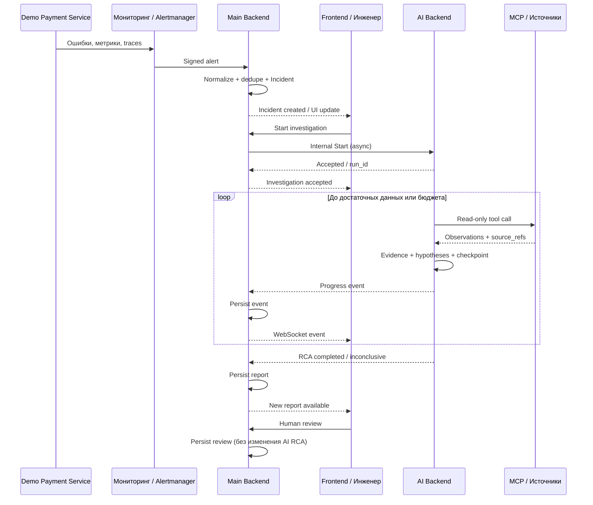

# 09. Сквозная картина — что происходит и кто что делает

**Перспектива:** один инцидент одновременно глазами пользователя, UI, Main Backend, AI и инфраструктуры.

## 1. Главный пользовательский путь

**Сценарий:** в демонстрационном `payment-service` появились ошибки HTTP 500 после изменения поведения сервиса. Инженер пытается понять их причину.

Диаграмма описывает **целевой** workflow. Детали wire-протокола Main↔AI задаёт актуализированный контракт, а не эта схема.

## 2. Одна история по шагам

| Время | Что произошло | Где остаётся факт | Что видит человек |
|---|---|---|---|
| T0 | Виртуальные платежи работают | PG платежного сервиса, telemetry | Healthy baseline в Grafana |
| T1 | Демо-сбой вызывает ошибки | Loki, Prometheus, Tempo | Рост HTTP 5xx и задержки |
| T2 | Alertmanager обнаруживает порог | Alert payload | Новый Incident в Overview |
| T3 | Backend нормализует, дедуплицирует | Incident DB | `INC-...` со статусом Open |
| T4 | Инженер запускает Investigation | Investigation registry | `running`, live status |
| T5 | AI читает logs/metrics/traces | MCP results → Evidence | записи tool calls, факты |
| T6 | AI обновляет hypotheses | Run state + events | Hypotheses, confidence, links |
| T7 | AI формирует RCA / inconclusive | RCA в Main Backend | RCA report + limitations |
| T8 | Инженер подтверждает/исправляет | Review/audit | Review status |
| T9 | Инженер исправляет неисправность | внешняя среда | После подтверждения — Resolved |

**T1/T2/T3 не гарантируют фиксированную разницу во времени.** Система не должна выдумывать точные timestamps ради красивой демонстрации.

## 3. Кто отвечает за действие

| Действие | Frontend (Расул) | Backend (Юрий) | AI (Олег) | Infra/demo (Даниил) |
|---|---|---|---|---|
| Создать технический сбой | показывает последствия | принимает alert | пока ничего | **реализует demo scenario** |
| Регистрация инцидента | показывает | **создаёт / хранит** | не участвует | источник сигналов |
| Start Investigation | инициирует | **проверяет и маршрутизирует** | **исполняет** | готовность источников |
| Tool calls | визуализирует | обеспечивает разрешённый контекст/интеграцию | **выбирает и вызывает** | telemetry/endpoints |
| Сохранение событий | отображает | **пишет в БД, раздаёт WS** | публикует | — |
| Evidence/RCA | показывает / раскрывает | **хранит и выдаёт** | **формирует** | поставляет реальные данные |
| Review | интерфейс | **валидирует и хранит** | не исправляет свой отчет | — |
| Исправление сбоя | может показывать статус | сохраняет статус Incident | только предлагает | восстанавливает демосреду |

Точная физическая принадлежность MCP Server — отдельная архитектурная граница; функционально он предоставляет **read-only source adapters** и контроль scope.

## 4. Три исхода одного расследования

### A. Удалось установить вероятную причину

AI видит реальные признаки насыщения пула: ошибки ожидания DB connection, рост времени ответа и корреляцию с конкретным изменением. Он возвращает `completed`, указывает root cause с evidence references, confidence не выше того, что оправдано источниками. Человек может подтвердить.

### B. Данных недостаточно

Есть только алерт «HTTP 500», а логи недоступны, запрос метрик завершился ошибкой. AI возвращает `inconclusive`, перечисляет ограничения, не делает категорический вывод. UI показывает состояние как полноценный исход работы, не как «LLM не справилась».

### C. Инструмент или модель недоступны

Результат вызова инструмента может быть `error/partial/truncated`; в событиях видно, что произошло. Если восстановить нельзя, run завершается `failed` или `timed_out` с историей. WebSocket-разрыв отдельно не останавливает AI.

## 5. Чего нельзя делать ради демонстрации

- Вшивать в prompt агента строку `root_cause=db_pool_exhaustion`.
- Создавать link на несуществующий лог/trace/commit.
- Генерировать `completed` только потому, что прошёл фиксированный таймер.
- Считать «AI сказал правильно» доказательством корректного инструментального расследования.
- Автоматически переключать Incident в Resolved после генерации текста.

## 6. Минимальный демонстрационный приёмочный проход

1. Запущены Frontend, Main Backend, AI Backend и логически доступные инструменты.
2. `payment-service` генерирует здоровый baseline и контролируемый fault.
3. Webhook рождает Incident один раз даже при повторе.
4. Engineer нажимает Start, видит живые tool events и получает реальные Evidence.
5. Agent выводит RCA/`inconclusive` в схеме, Main Backend сохраняет его.
6. После обрыва WebSocket UI догружает события.
7. Инженер подтверждает/корректирует RCA; исправление/восстановление выполняется отдельно.

См. [MVP](10_SCOPE_AND_ACCEPTANCE.md).
