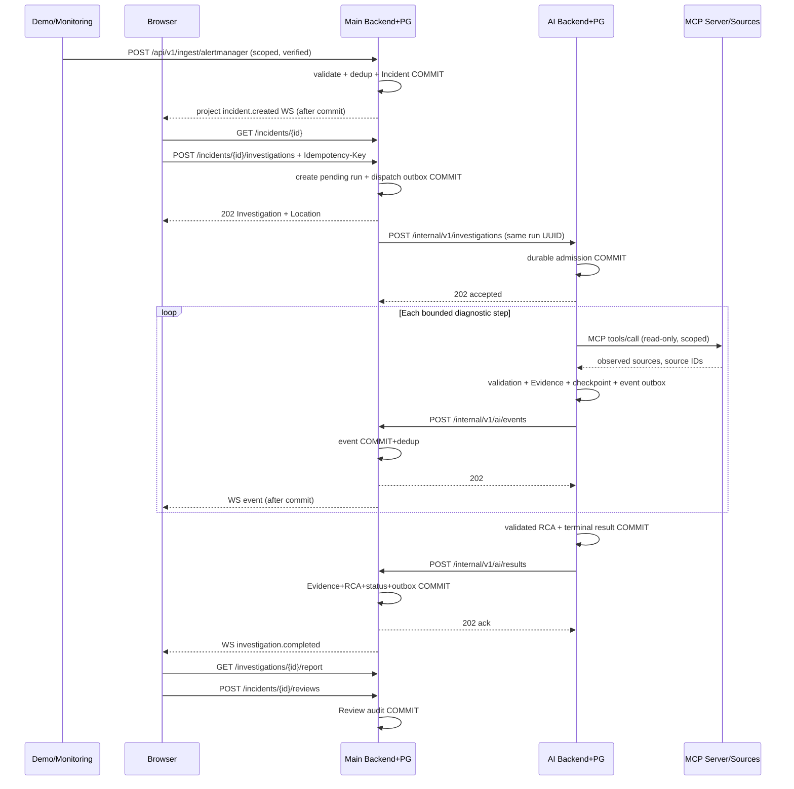

# 09. Сквозное исполнение — технические sequence-сценарии

Этот файл предназначен для совместной отладки. Он не заменяет [12 — wire contracts](12_INTERSERVICE_CONTRACTS.md), а привязывает их к времени, транзакциям, HTTP кодам и состояниям. Владелец каждого перехода: [13 — handoff](13_INTEGRATION_AND_HANDOFF.md).

## 1. Happy path: fault → Incident → run → RCA → review

### Transaction boundaries

- **T1 Main:** Incident + alert link + outbox; без транзакции недопустим WS `incident.created`.
- **T2 Main:** run metadata `pending` + dispatch job; 202 browser после commit, не после ответа LLM.
- **T3 AI:** durable registry accepted; 202 internal после commit.
- **T4 AI:** Evidence/checkpoint и callback outbox; не терять event при restart.
- **T5 Main:** event insert/upsert + projection; 202 ack после commit.
- **T6 AI:** final report + terminal status + outbox; возможен readback.
- **T7 Main:** validate + Evidence/Hypothesis/Timeline/RCA + terminal status **одной транзакцией**, потом terminal WS.
- **T8 Main:** human Review + audit; Incident resolved только отдельным ручным действием.

## 2. Ошибка AI busy

Main сохранит `pending` и dispatch job, AI на Start ответит `429 Retry-After: 5`. Dispatcher retry того же ID после backoff. Browser получит корректный `pending`, а не 500 или бесконечный spinner. По bounded admission deadline Main явно закроет попытку `failed`, сохранив failure_code и события. Нельзя создавать новый run ID на каждом retry Start.

## 3. WebSocket упал в середине

1. Browser последний раз применил seq=10, WS disconnect. AI продолжает.
2. Main persist seq=11,12,13 и terminal result в DB; отсутствие браузера не важно.
3. Browser после reconnect `GET run`, `GET events?after_sequence=10`, применяет 11–13 и получает report, затем подписывается на WS с `after_sequence=13`.
4. Если получил WS seq=15 до REST seq=14, буферизует 15; не считает дырку допустимой.
5. Дубль seq=13 от WS отбрасывает по `(run,sequence)`.

## 4. AI crash и недоставленный RCA

1. AI успел закоммитить `ai_results` и `ai_outbox`, но упал до callback.
2. При рестарте runner видит terminal result, delivery worker повторяет callback с тем же ID/status.
3. Дополнительно Main reconciliation делает `GET /internal/v1/investigations/{id}/result` и импортирует независимо от callback.
4. Если callback и readback пришли одновременно, unique investigation report + idempotent transaction создаёт только один набор Evidence/RCA, Main отвечает deduplicated.
5. Если AI упал до результата, lease истекает, executor возобновляет из LangGraph checkpoint **только если safe**; иначе фиксирует failed, не оставляет forever running.

## 5. Cancel одновременно с completion

- Main записывает `cancel_requested` и отправляет command.
- AI перед следующим шагом видит отмену и готовит `canceled`, но в это время completion может успеть закоммититься.
- Побеждает **первая принятая терминальная транзакция**, другая не меняет run, регистрируется конфликт.
- UI показывает `cancel requested` до появления terminal; не обещает мгновенно остановить уже завершённый tool request.
- Retry всегда новый investigation UUID.

## 6. Inconclusive — не инфраструктурный failure

При недоступных логах и лишь кратком сигнале «5xx» AI может вернуть валидный `inconclusive`, `root_cause=null`, limitations. Main сохраняет report и переводит Incident в `awaiting_review`; UI показывает «Недостаточно доказательств», даёт доступ к частичным Evidence и Review. Не выдумывать RCA из названия fault сценария.

## 7. Один реально проверяемый end-to-end сценарий для команды

**Предусловия:** k3d ready, payment service healthy, test project/environment/service mapping, Main/AI internal auth, MCP с Loki/Prometheus/Tempo, браузер участников проекта с правами запуска и только чтения.

| № | Исполнитель | Действие | Что проверить |
|---|---|---|---|
| 1 | Даниил | здоровый payment traffic | baseline HTTP 2xx, source telemetry |
| 2 | Даниил | включить `psp_timeout`, ограниченный TTL | реальные provider timeout spans/errors |
| 3 | Юрий | принять Alertmanager webhook (либо manual Incident) | один incident UUID, dedup |
| 4 | Расул | открыть Incident/Start | 202 pending with stable ID |
| 5 | Юрий | dispatch Start to AI | 202 admission; no RabbitMQ |
| 6 | Олег | запустить LangGraph/MCP диагностические reads | valid source refs; no secret leaks |
| 7 | Юрий+Расул | events GET/WS, искусственный reconnect | contiguous replay, no dup |
| 8 | Олег+Юрий | terminal report callback | RCA/evidence atomically persisted |
| 9 | Расул | Review confirmed/corrected | original report unchanged |
| 10 | Даниил | отключить fault, healthy traffic | telemetry normalization/recovery |
| 11 | QA | compare evaluator ground truth | evidence-backed diagnosis, no hints |

**Definition of Done:** каждый шаг реально пройден со ссылками на тестовые артефакты; unit/fake model success нельзя называть живым E2E. Проверки отказов перечислены в [14](14_ACCEPTANCE_AND_CONTRACT_TESTS.md).

## 8. Проверяемые схемы для данного сценария

Public Start и Review → [Public API](contracts/openapi/main-public.openapi.yaml); durable acceptance and GET result → [AI API](contracts/openapi/ai-internal.openapi.yaml); progress/result callback → [Main callbacks](contracts/openapi/main-callbacks.openapi.yaml); WS replay → [WebSocket](contracts/WEBSOCKET.md); наблюдения → [MCP](contracts/MCP_AND_TELEMETRY.md). Проверять нужно всю последовательность, а не только отдельно валидный JSON.
