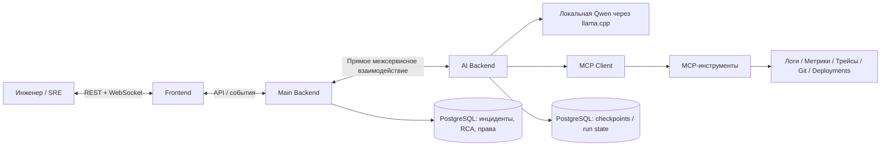

# AI Incident Investigator

> **Документация продукта через разные точки зрения**  
> Версия: `product-perspectives/1.0` · 24 октября 2026 · Язык: русский  
> Основа: предоставленный пакет `AI_Incident_Investigator_API_Contracts v0.2`, ранее сформированные требования к UI (Figma B), текущие договорённости команды.

**AI Incident Investigator** — платформа, которая помогает инженерам расследовать технические инциденты в микросервисных приложениях. Она не просто сообщает, что «платежи возвращают 500», а собирает данные из систем наблюдаемости и кода, проверяет гипотезы, предлагает вероятную первопричину и действия по её устранению. **Решение остаётся за человеком:** агент не исправляет production автоматически.

Этот комплект отвечает на один вопрос с разных сторон: **что мы строим, для кого, как это работает, что видит пользователь и какая часть системы за это отвечает**. Он намеренно **не переписывает** весь черновой OpenAPI и JSON Schema и **не изображает будущие функции уже реализованными**.

## Навигация

| № | Документ | Главный вопрос | Кому читать |
|---|---|---|---|
| 00 | [Продукт](00_PRODUCT.md) | Что это такое, какую проблему решает, какой результат даёт? | Всем, сначала |
| 01 | [Бизнес-логика](01_BUSINESS_LOGIC.md) | Что происходит с момента подключения проекта до закрытия инцидента? | Всем |
| 02 | [Use cases](02_USE_CASES.md) | Что делает пользователь в конкретной ситуации, что отвечает система? | Product, QA, Front, Back, AI |
| 03 | [UI / UX](03_UI_UX.md) | Что находится на экранах, как человек понимает происходящее? | Front, дизайн, product |
| 04 | [Frontend](04_FRONTEND.md) | Какие данные получает браузер и как работает realtime? | Расул, Юрий |
| 05 | [Backend](05_BACKEND.md) | Кто хранит данные, принимает команды, защищает доступ? | Юрий, Олег |
| 06 | [AI-агент](06_AI_AGENT.md) | Как агент расследует и формирует доказательный RCA? | Олег, Юрий |
| 07 | [Заказчик и ценность](07_CUSTOMER.md) | Кто купил бы продукт, зачем и как оценивать пользу? | Заказчик, руководитель, команда |
| 08 | [Инфраструктура и демостенд](08_INFRA_AND_DEMO.md) | Где всё работает и на чём демонстрируем инциденты? | Даниил, Олег, Юрий |
| 09 | [Сквозные сценарии](09_END_TO_END.md) | Как связаны все части в одном расследовании? | Всем, для синхронизации |
| 10 | [Границы MVP и приёмка](10_SCOPE_AND_ACCEPTANCE.md) | Что обязательно работает к первой демонстрации? | Всем |
| 11 | [Источники и статус решений](11_SOURCES_AND_DECISIONS.md) | Что опирается на архив, что изменилось позже, что не надо выдумывать? | Разработчикам / Codex |

## Как читать, чтобы не тратить контекст зря

- **Для общего понимания и презентации:** `README → 00 → 07 → 02 → 09`.
- **Для Frontend:** `README → 03 → 04 → 01 → 02`.
- **Для Backend:** `README → 01 → 05 → 09 → 11`.
- **Для AI Backend:** `README → 01 → 06 → 09 → 11`.
- **Для Demo/Infra:** `README → 08 → 09 → 10`.
- **Для Codex:** этот README + **один профильный документ и актуальный контракт**, а не весь пакет сразу.

## Общая модель продукта

**Важно:** на схеме отражены **логические обязанности**. Из документа не следует, что каждый прямоугольник — отдельный развернутый микросервис. MCP-слой логически отделён, но его физическое размещение требует согласования командой. В актуальной инфраструктуре для логов есть **Loki**; исходный v0.2-каталог описывал **Elasticsearch**, поэтому адаптер логов должен быть согласован с фактическим источником.

## Семь фундаментальных правил

1. **Incident ≠ Investigation.** Инцидент описывает проблему, investigation — конкретную попытку AI-разбора. У одного инцидента может быть несколько попыток.
2. **Только факты.** Агент не придумывает логи, метрики, trace ID, коммиты или ссылки. Любой значимый вывод связан с Evidence.
3. **Human-in-the-loop.** RCA — предложение с доказательствами; человек подтверждает, исправляет или отклоняет. Завершение расследования не закрывает инцидент автоматически.
4. **Read-only диагностика.** AI не делает restart, rollback, patch, SQL write или произвольные shell-команды.
5. **Асинхронность.** Расследование может длиться до 20 минут; пользователь видит ход, а WebSocket можно переподключить без потери run.
6. **Без RabbitMQ между Main Backend и AI Backend.** Это более позднее решение команды и оно важнее прежних схем.
7. **MVP прежде расширений.** Рабочее расследование важнее декоративных дашбордов, чата и RAG.

## Как выглядит успех за одну минуту

Инженер замечает «`payment-service` возвращает HTTP 500». Открывает инцидент, запускает расследование и видит действия агента. Агент проверяет логи, рост DB pool timeouts, p95 и историю deployment, находит подтверждающие записи и формирует RCA. Инженер открывает каждое доказательство, принимает или корректирует вывод и самостоятельно исправляет проблему. Система сохраняет всю историю для аудита.

## Что означает «описано» и «сделано»

Это **продуктовая документация**, не отчёт о готовности программного кода. Сейчас существуют UI-макеты/каркас, FastAPI-каркасы, локальная интеграция Qwen через LangGraph и инфраструктурные конфигурации. Полный MCP→RCA→WebSocket end-to-end и приёмка продукта **не подтверждены**. Не путайте требования, предложенные решения и фактически работающие компоненты.

---

**Первый документ:** [00 — Продукт](00_PRODUCT.md).  
**Проверка ожиданий:** [10 — MVP и приёмка](10_SCOPE_AND_ACCEPTANCE.md).
