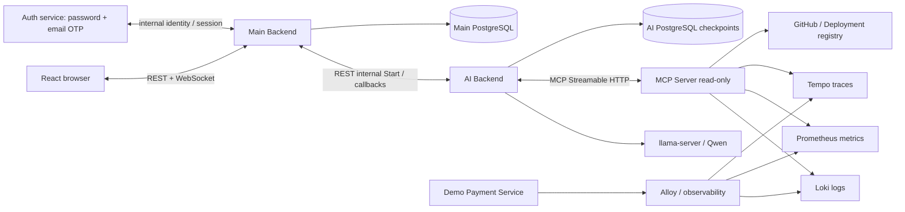

# AI Incident Investigator — документация продукта и технический baseline

**Редакция:** `product-perspectives/3.0-proposed` · 25 октября 2026. **Язык:** русский. **Статус:** рабочая спецификация для общего инженерного ревью; не равна реализованному production коду. Источник — архив API Contracts v0.2, текущие Figma/UI и repo-практики команды. **Что было изменено в v2:** вместо поверхностных описаний Frontend, Backend и AI добавлены реальные контракты, модели данных, runtime и интеграционная схема.

> **Кратко о продукте:** инженер видит технический Incident, запускает AI Investigation, получает Evidence из логов/метрик/трейсов/Git/deployments, проверяет гипотезы и RCA, затем подтверждает/корректирует результат. AI не исправляет production автоматически.

## Контракты для разработки — не только Markdown

**[contracts/README.md](contracts/README.md)** — главное место для разработчиков API и Codex. В каталоге находятся три отдельных OpenAPI (публичный Main, приватный AI, приватные AI callbacks), валидируемые JSON Schema WebSocket/MCP/ingestion, каталог read-only инструментов, проверенные JSON-примеры и локальная проверка `python contracts/tests/validate_contracts.py`.

**Для codegen:** Расул берёт `contracts/openapi/main-public.openapi.yaml` и `contracts/schemas/websocket.schema.json`; Юрий — public/callbacks OpenAPI; Олег — `ai-internal.openapi.yaml`, `main-callbacks.openapi.yaml` и `mcp/tool-catalog.json`. Не переносить старые кандидаты REST/gRPC и `Elasticsearch` из архивов.

**Совместимость:** изменения v3 — **предложение для согласования**, не автоматически внедрённый API. Перед заменой DTO в реальном коде каждый владелец выполняет consumer/provider contract tests из [матрицы](contracts/CONTRACT_MATRIX.md).

**Фактическое имя документа 08:** `08_INFRA_AND_DEMO.md`. В старой ветке GitHub файл ошибочно назывался `08_INFRA_AND_DEMO 1.md`; после применения пакета старое имя нужно удалить (см. `APPLY_TO_REPO.md`).

## 1. Навигация: читать не всё сразу

| № | Документ | На какой вопрос отвечает | Аудитория |
|---|---|---|---|
| 00 | [PRODUCT](00_PRODUCT.md) | Что это за продукт, какая ценность, границы | Все / заказчик |
| 01 | [BUSINESS LOGIC](01_BUSINESS_LOGIC.md) | Как работает Incident → Investigation → Review | Все |
| 02 | [USE CASES](02_USE_CASES.md) | Что делает пользователь и что возвращает система | PM, QA, Front/Back |
| 03 | [UI/UX](03_UI_UX.md) | Экраны, состояния, вкладки и навигация | Расул |
| **04** | **[FRONTEND TECHNICAL](04_FRONTEND.md)** | **React модули, REST/WS SDK, состояние, auth, replay, тесты** | **Расул** |
| **05** | **[MAIN BACKEND TECHNICAL](05_BACKEND.md)** | **БД, RBAC, ingestion, REST, durable dispatch, callbacks, WS** | **Юрий** |
| **06** | **[AI AGENT TECHNICAL](06_AI_AGENT.md)** | **LangGraph, LLM, MCP, evidence, PG checkpoints, runtime** | **Олег** |
| 07 | [CUSTOMER](07_CUSTOMER.md) | Как оценивает полезность заказчик | PM / заказчик |
| **08** | **[INFRA + DEMO](08_INFRA_AND_DEMO.md)** | **k3d, Prom/Loki/Tempo, payment scenarios, telemetry labels** | **Юра/Даниил** |
| **09** | **[END TO END](09_END_TO_END.md)** | **Полная HTTP/DB/WS последовательность и recovery** | **Все** |
| 10 | [MVP/ACCEPTANCE](10_SCOPE_AND_ACCEPTANCE.md) | Что входит в MVP, что не входит | Все |
| **11** | **[SOURCES/DECISIONS](11_SOURCES_AND_DECISIONS.md)** | **Что известно, что выбрано в v2 и что пока не реализовано** | **Все** |
| **12** | **[INTERSERVICE CONTRACTS](12_INTERSERVICE_CONTRACTS.md)** | **Единые REST/WS/MCP контракты, JSON, errors, RBAC** | **Front/Back/AI** |
| **13** | **[INTEGRATION & HANDOFF](13_INTEGRATION_AND_HANDOFF.md)** | **Кто что отдаёт и в каком порядке интегрироваться** | **Вся команда** |
| **14** | **[ACCEPTANCE & CONTRACT TESTS](14_ACCEPTANCE_AND_CONTRACT_TESTS.md)** | **Конкретные тесты и PASS/FAIL gates** | **QA/вся команда** |

**Для первого чтения заказчиком:** `00 → 01 → 02 → 03 → 07`. **Для разработки:** `README → 12 → свой профильный 04/05/06/08 → 13 → 14`. Не передавать Codex весь архив за один запрос: одну Story + профильный документ + конкретный раздел контракта.

## 2. Главная архитектура

**Ключевые границы:** Browser не обращается к AI/MCP; Main владеет Incident, RCA и Review; AI владеет расследованием и его execution state; MCP только read-only; Infra поставляет настоящие диагностические данные. RabbitMQ между Main и AI нет.

## 3. Решения рабочего baseline v2

| Вопрос | Один выбранный путь |
|---|---|
| Main ↔ AI | **REST JSON**, прямой private API, service identity |
| AI агент | Один ReAct LangGraph на Qwen через llama.cpp |
| MCP | Внутренний AI-owned Streamable HTTP Server, read-only |
| Логи | **Loki**, не Elasticsearch из исторических схем |
| Метрики / трейсы | Prometheus / Tempo через существующий Alloy |
| Auth | Password → email OTP каждый новый вход; refresh HttpOnly cookie |
| WebSocket auth | 30-секундный single-use HttpOnly WS ticket cookie, Origin check |
| Long-running runs | PostgreSQL registry/checkpoints, Main dispatch/outbox, no HTTP 20min |
| AI busy | 429 + Retry-After, Main durable bounded retry |
| Reliable result | AI callback + GET result readback, Main atomic persistence |
| AI budget | ≤20 steps, ≤40 tool calls, ≤1200 sec, 1 active executor MVP |
| RAG | P2, не условие MVP |

**Статус решений:** первые доменные принципы подтверждены историей проекта; конкретный выбор транспорта, MCP deployment и cookie-механизма в этой редакции — **целевой проектный baseline для утверждения командой**, а не утверждение о уже принятых всеми решениях. До codegen старые машинные OpenAPI/JSON Schema надо синхронизировать по [11](11_SOURCES_AND_DECISIONS.md). Это единое направление реализации; не делать альтернативный вариант без ADR.

## 4. Что должен сделать каждый разработчик

**Расул — Frontend:** Login/OTP, Incident UI, Live WS reducer, Evidence/RCA/Review. Получает от Юрия public OpenAPI и event fixtures. Читает [04](04_FRONTEND.md), [12](12_INTERSERVICE_CONTRACTS.md) §3–§4,§6, [13](13_INTEGRATION_AND_HANDOFF.md).

**Юрий — Backend:** scoped Project/Service/Incident, durable Investigation dispatch, internal AI HTTP, event/result sink, WS replay, Review, audit. Отдаёт Расулу OpenAPI и Олегу internal callbacks. Читает [05](05_BACKEND.md), [12](12_INTERSERVICE_CONTRACTS.md), [13](13_INTEGRATION_AND_HANDOFF.md).

**Олег — AI:** tool calling verification, Pydantic domain, single LangGraph agent, MCP Loki/Prom/Tempo, Evidence/RCA, PG durable executor, callbacks. Отдаёт Юрию internal REST contract/fixtures. Читает [06](06_AI_AGENT.md), [12](12_INTERSERVICE_CONTRACTS.md) §5–§6, [13](13_INTEGRATION_AND_HANDOFF.md).

**Даниил — Infra/Demo:** payment-service, healthy + controlled faults, k3d observability source readiness, Grafana dashboards, runbook. Отдаёт остальным настоящие labels/source IDs/time windows, без подсовывания AI готового ground truth. Читает [08](08_INFRA_AND_DEMO.md) и [13](13_INTEGRATION_AND_HANDOFF.md) §4–§5.

## 5. Как начать разработку без ожидания других

1. Команда утверждает baseline v2, исправляет расхождения старого v0.2 в canonical OpenAPI/Schema/fixtures.
2. Юрий поднимает public mock и internal fake AI; Расул делает UI на fixtures; Олег делает graph + fake MCP; Даниил поднимает payment telemetry.
3. Юрий ↔ Олег проверяют реальный Start/events/result HTTP; только затем Расул переключает UI на настоящий Main.
4. G01 — локальная проверка агента **перед AI-10 Postgres checkpoints**. Следующая G02 — долгоживущее исполнение и интеграция. G03 — полный browser-to-demo scenario.
5. Каждый PR предоставляет: contract change, unit tests, integration tests (или NOT RUN), error paths, reproducible smoke.

**Где подробности:** [13 — конкретные handoffs](13_INTEGRATION_AND_HANDOFF.md) и [14 — acceptance](14_ACCEPTANCE_AND_CONTRACT_TESTS.md).

## 6. Чего этот документ не утверждает

Наличие файла с маршрутом **не означает**, что он реализован. Реально проверена локальная интеграция AI-01 с Qwen; полноценный MCP→RCA→Main→Frontend сценарий пока является целевой архитектурой. `v0.2-draft` машинные схемы не синхронизированы автоматически при изменении Markdown. Не копируйте примеры в production без auth/scope/contract тестов.
